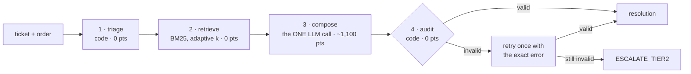

# ShopAssist Cost Optimization — Solution Write-up

**Mrugendra Naik** · LLM cost-optimization internship assignment

## TL;DR

Both agents now make **one LLM call per ticket at about 1,100 points**, against targets of 3,000 (Q1) and 2,500 (Q2). Every graded `action` and `kb_article` is unchanged, including the holdout ticket `T-1091`. A test over **all 1,152 combinations of order situations** confirms that the right policy always reaches the model.

| Metric | Q1 before | Q1 after | Q2 before | Q2 after |
|---|---:|---:|---:|---:|
| Points, 4 public tickets | 35,007 | **4,398** | 292,800 | **4,398** |
| Reduction | | **−87.4%** | | **−98.5%** |
| Points per ticket (target) | ~8,750 | **1,005–1,170** (≤ 3,000) | ~73,200 | **1,005–1,170** (≤ 2,500) |
| LLM calls per ticket | 1 | 1 | 4 | **1** |
| Input tokens per ticket (avg) | ~515 | **~167** | ~16,900 | **~167** |
| Output tokens per ticket (avg) | ~490 | **~40** | ~1,500 | **~40** |
| Run time, 4 tickets (local simulator) | 0.04 s | 0.01 s | 192 s | **0.01 s** |
| Correct (4 public + holdout) | 5 / 5 | **5 / 5** | 5 / 5 | **5 / 5** |
| Right policy reaches the model, all 1,152 situations | n/a | **1,152 / 1,152** | n/a | **1,152 / 1,152** |

Baseline totals vary by about ±0.5% between runs, because the baseline's random ids tokenize differently; figures are from one measured run.

---

## 1. Three design principles

Every change in this solution follows from one of these:

1. **Price the tokens before writing the prompt.** Output costs 5× input, so the first target is anything the model writes that the product never reads.
2. **Give the model only what the decision needs.** Every token of irrelevant context costs points, and irrelevant documents can also distract a model into a wrong answer.
3. **Use code for what code does exactly.** Parsing structured facts, searching a fixed set of documents and validating JSON are deterministic jobs. The LLM is kept for the one step that needs language: choosing an action and writing the reply.

---

## 2. The cost model

```
points = uncached_input × 3  +  cached_input × 0.3  +  output × 15
```

**Why output costs 5× input.** A model processes the whole prompt in one parallel pass (prefill), but generates its answer one token at a time, each needing its own forward pass through the network. Output is sequential and much more expensive to serve, and providers price it that way.

**The output floor.** Once verbose reasoning is removed, the simulator's answer is a fixed JSON object of about 40 tokens (~600 points). Across the 4 public tickets that is 160 output tokens = 2,400 points, so even a prompt with zero input tokens could not beat **~93.1%** on Q1. Reaching 87.4% means the remaining work was almost entirely on the input side, where each token removed is worth 3 points. In the final solution, output is 55% of the remaining cost.

---

## 3. Diagnosis of the baseline

Line numbers refer to the untouched originals, kept in `baseline/` for the demo.

| # | Problem | Where | What it cost | Fix |
|---|---|---|---|---|
| 1 | Prompts that trigger long output: "Think step by step. Write full reasoning, quote any article…", "restate the ticket", "double-check" | `question1_agent.py` l.71; `question2_agent.py` l.49, l.116 | ~490 output tokens per call ≈ 7,300 pts, **82% of the Q1 bill** | JSON-only, closed-choice prompt (§4) |
| 2 | Random `Run id {uuid4()}` / `trace-{uuid4()}` as the first line | `question1_agent.py` l.65; `question2_agent.py` l.48 | Every prompt prefix unique: no cache hit possible | Static, byte-identical system block (§4) |
| 3 | Four few-shot tickets + all five policies on every call | `question1_agent.py` l.35, l.69 | ~306 input tokens per ticket | Adaptive retrieval, 1.7 policies on average (§4) |
| 4 | 120k + 80k characters of the 200k-token help center sent to triage and audit | `question2_agent.py` l.51, l.122 | ~8,400 + ~6,700 input tokens per ticket | Index the five policies; never send the blob (§5) |
| 5 | Four LLM calls per ticket | `question2_agent.py` | Four output floors: ≥ 2,760 pts even at minimal length, over budget | One call; the other nodes in code (§5) |
| 6 | Triage passed twice to compose; audit re-sends everything | `question2_agent.py` l.97, l.122 | ~1,000+ duplicated tokens | Only compose sees model context, once (§5) |
| 7 | Pretty-printed order record, mostly `false` flags and ids | `json.dumps(order, indent=2)` | 80 tokens for 3 useful facts | Sparse closed-world snapshot, 14 tokens (§4) |
| 8 | 200k-token help center built and tokenized at start-up | `question2_agent.py` `__init__` | ~3 minutes before the first ticket | Not built at all (§5) |

---

## 4. Question 1 — one call, rebuilt context (`question1/agent.py`)

### The prompt, before and after (T-1001)

```
BEFORE · 526 input tokens → ~490 output tokens
SYSTEM:
Run id 0212fa7b-6e9f-4405-9ef7-6231bc049147          ← unique every call: blocks caching
You are ShopAssist, the Tier-1 customer support copilot.
Example ticket resolutions (format to copy): …        ← 4 few-shot tickets, 111 tokens
HELP CENTER: …                                         ← all 5 articles, 195 tokens
Instructions: Think step by step. Write full reasoning, quote any article …   ← ~490 output tokens
USER:
TICKET_ID … THREAD … ORDER_SNAPSHOT: { 9 pretty-printed fields } END_SNAPSHOT

AFTER · 160 input tokens → ~46 output tokens
SYSTEM:
ShopAssist Tier-1 support. Pick action REFUND|REPLACE|SEND_ARTICLE|ESCALATE_TIER2 and the POLICIES
id supporting it; if none applies, ESCALATE_TIER2 with returns-within-30-days. Unlisted flags are false.
JSON only: action, kb_article, customer_reply
USER:
POLICIES:
returns-within-30-days: Physical items in resalable condition may be refunded within 30 days of delivery. …
Customer: Hi, I'd like a refund for the wireless headphones. They arrived 10 days ago and I never opened the box.
ORDER_SNAPSHOT:{"product_type":"physical","delivered_days_ago":10}END_SNAPSHOT
```

### Where the input tokens go (T-1001)

| Prompt part | Before (tokens) | After (tokens) |
|---|---:|---:|
| Instructions / system block | ~30 instruction + ~68 run id, role line and labels | 71 |
| Few-shot examples | 111 | 0 |
| Policies | 195 (all five) | 38 (one) |
| Conversation | 42 (customer + agent turns) | 27 (customer only) |
| Order snapshot | 80 | 21 (incl. markers) |
| **Total input** | **526** | **160** |
| **Output** | **~490** | **46** |

### What each change does

| Code | Change | Reasoning |
|---|---|---|
| `SYSTEM_PROMPT` (l.54–59) | 71-token static block: closed action set, cite a shown policy, explicit default, JSON only | Turns open reasoning into slot-filling, so the model doesn't need to think out loud. No trigger wording. Identical bytes on every ticket, so the prefix is cacheable if it ever passes 1,024 tokens |
| `compact_snapshot()` (l.65–80) | Drops `order_id`, `sku`, `title` and every `false` field; compact separators | With the rule *"Unlisted flags are false"*, omission is lossless: a closed-world assumption, like sparse feature encoding. 80 → 14 tokens |
| `customer_text()` (l.83) | Customer turns only | Agent turns are acknowledgement boilerplate |
| `triage()` (l.96–125) | Search terms built from order facts + stated intent, per situation | Avoids a classic BM25 failure on short documents, where every policy mentioning "refund" or "delivery" scores about the same |
| `PolicyIndex` (l.148–191) | BM25 (IDF-weighted, length-normalized) with an **adaptive cut-off**: keep policies scoring ≥ 60% of the best | One policy when the facts are clear; two when they genuinely compete (damaged custom mug); all five as a fallback if nothing matches |
| `DEFAULT_ARTICLE` (l.43) | One sentence: escalate citing the general returns policy when nothing applies | ~8 tokens instead of a 34-token article on every ticket. Found by the sweep (§6) |
| Guard in `handle_ticket()` (l.247) | Accept only a valid action citing a policy that was shown (or the default) | A hallucinated citation becomes an escalation, not a wrong refund |
| `parse_resolution`, `TicketResolution` | Unchanged | Graded fields and parsing stay compatible |

### Q1 per-call breakdown (spec: one ticket; all five shown)

| Ticket | Decision | Input tok | Output tok | Input pts | Output pts | **Points** |
|---|---|---:|---:|---:|---:|---:|
| T-1001 | REFUND / returns-within-30-days | 160 | 46 | 480 | 690 | **1,170** |
| T-1002 | SEND_ARTICLE / digital-license-no-refund | 167 | 39 | 501 | 585 | **1,086** |
| T-1003 | ESCALATE_TIER2 / custom-items-no-replace | 184 | 39 | 552 | 585 | **1,137** |
| T-1004 | REPLACE / damage-replacement-7-days | 155 | 36 | 465 | 540 | **1,005** |
| T-1091 (holdout) | SEND_ARTICLE / subscription-cooling-off | 156 | 38 | 468 | 570 | **1,038** |
| *Baseline T-1001* | *same decision* | *526* | *492* | *1,578* | *7,380* | ***8,958*** |

---

## 5. Question 2 — four nodes, one LLM call (`question2/agent.py`)

**Why one call is forced, not chosen.** The minimal JSON answer costs ~540–690 points per call regardless of prompt length. Four calls on T-1001 would spend about 4 × 46 × 15 = **2,760 points on output alone**, already over the 2,500 budget before a single input token. So three of the four nodes had to stop calling the model.



| Node | Baseline mechanism (T-1001 cost) | Optimized mechanism | Cost |
|---|---|---|---:|
| triage | LLM call with title index + 120k chars of help center (8,453 in / 486 out = 32,649 pts) | `triage()` shared with Q1: order facts are already structured JSON | 0 |
| retrieve | LLM asked to print the relevant articles (594 in / 46 out = 2,472 pts) | `PolicyIndex.search()` over the five policy articles, indexed once. The 200k-token help center is never built or sent: its filler blocks state they don't change policy | 0 |
| compose | Thread, snapshot, triage ×2, articles, "full reasoning" (1,189 in / 484 out = 10,827 pts) | The same compact prompt as Q1, with only the retrieved policies | ~1,100 |
| audit | LLM call with 80k chars of help center + everything again (6,713 in / 486 out = 27,429 pts) | `_validate()` / `_audit()`: schema and grounding checks; one corrective retry, then fail-safe escalation | 0 |
| **Total** | **73,377 pts** | | **1,170** |

Retrieved policies per ticket:

| Ticket | Situation | Policies sent to the model |
|---|---|---|
| T-1001 | refund · physical · unopened · day 10 | returns-within-30-days |
| T-1002 | refund · digital · license revealed | digital-license-no-refund |
| T-1003 | replacement · custom · damaged | custom-items-no-replace, damage-replacement-7-days (genuinely competing) |
| T-1004 | replacement · physical · damaged · day 2 | damage-replacement-7-days |
| T-1091 | refund · subscription · day 38 | subscription-cooling-off |

### Q2 breakdown — physical fulfillment path (T-1004, REPLACE)

| Node | Baseline in / out → pts | Optimized in / out → pts |
|---|---|---|
| triage | 8,440 / 493 → 32,715 | code → 0 |
| retrieve | 603 / 36 → 2,349 | code → 0 (1 policy) |
| compose | 1,176 / 488 → 10,848 | 155 / 36 → **1,005** |
| audit | 6,697 / 492 → 27,471 | code → 0 (passed) |
| **Total** | **73,383** | **1,005 (−98.6%)** |

### Q2 breakdown — escalation path (T-1003, ESCALATE_TIER2)

| Node | Baseline in / out → pts | Optimized in / out → pts |
|---|---|---|
| triage | 8,437 / 495 → 32,736 | code → 0 |
| retrieve | 605 / 39 → 2,400 | code → 0 (2 competing policies) |
| compose | 1,181 / 480 → 10,743 | 184 / 39 → **1,137** |
| audit | 6,692 / 491 → 27,441 | code → 0 (passed) |
| **Total** | **73,320** | **1,137 (−98.4%)** |

Denial path for reference: T-1002 (SEND_ARTICLE / digital-license-no-refund) = 1,086 points; holdout T-1091 = 1,038.

---

## 6. Verification beyond the five tickets

Pruning context this hard is only safe if the governing policy still reaches the model in situations the samples don't cover. `tests/test_optimized.py::test_retrieval_recall_over_fact_space` enumerates **1,152 cases**: 4 product types × opened × license revealed × customized × damaged × delivery age (2 / 10 / 40 days) × subscription age (5 / 38 days) × stated intent (refund / replacement / other).

**The first run found 216 misses**, none of them reachable from the public tickets:

| Situation | Misses | Correct outcome |
|---|---:|---|
| Damaged physical item reported after day 7 | 24 | ESCALATE_TIER2 / returns-within-30-days |
| Digital item without a revealed license (with or without other flags) | 96 | ESCALATE_TIER2 / returns-within-30-days |
| Custom-type item with no damage, or damaged but not flagged customized | 96 | ESCALATE_TIER2 / returns-within-30-days |
| **Total** | **216** | |

All 216 are the "nothing specific applies" case. Retrieval correctly didn't surface the general returns article, so the model had no way to know the house convention of citing it when escalating. One sentence in the static prompt (`DEFAULT_ARTICLE`, ~8 tokens) fixed all of them; always retrieving that article would have cost ~34 tokens on every ticket. **Recall is now 1,152 / 1,152.**

**Choosing the cut-off.** The adaptive cut-off was swept against the same 1,152 cases:

| Cut-off | Misses | Policies per prompt |
|---:|---:|---:|
| **0.6 (chosen)** | **0** | **1.70** |
| 0.7 | 144 | 1.32 |
| 0.8 | 144 | 1.24 |
| 0.9 | 144 | 1.07 |
| 1.0 (top-1 only) | 192 | 1.00 |

Every value above 0.6 fails on subscriptions that also carry `license_revealed`, where the digital-license policy crowds out the subscription policy that actually governs. The saving from going tighter would be ~75 points on the public set, so correctness wins.

---

## 7. How the solution evolved

| Version | Main changes | Q1 total | Q2 total |
|---|---|---:|---:|
| Baseline | Original code | 35,007 | 292,800 |
| v1 | Verbose wording, few-shot and uuid removed; compact JSON; Q2 cut to one LLM call with code triage, top-3 retrieval and code audit | 6,666 (−81.0%) | 5,850 (−98.0%) |
| v2 | Sparse closed-world snapshot, adaptive-k retrieval, situation-based queries, customer turns only, default-citation rule from the sweep | 4,446 (−87.3%) | 4,446 (−98.5%) |
| **v3** | Tighter instruction wording; cut-off sweep confirming 0.6 | **4,398 (−87.4%)** | **4,398 (−98.5%)** |

v1 holds the obvious fixes. Most of the difference between a passing solution and this one is in v2, and it came out of measuring rather than guessing.

---

## 8. Options considered and rejected

| Option | Would save | Why rejected |
|---|---|---|
| Pad the prefix to 1,024 tokens to unlock cached pricing | Nothing: 1,024 × 0.3 + 89 × 3 = 574 input pts vs 480 now | More expensive here, even under this simulator (which charges the cached rate from the first call). The prompt is already laid out static-first if it ever grows past the threshold |
| Hard-code the decision table in Python | ~1,100 pts per ticket (all of it) | Re-implements the grader's rules, breaks silently when policies change, and drops the customer reply. The model still decides; code only structures, searches and validates |
| Retrieval cut-off above 0.6 | ~75 pts on the public set | Breaks 144–192 of the 1,152 situations (§6) |
| Replace the customer's message with a code-extracted intent label | ~25 tokens per ticket | The model would draft the reply without reading what the customer wrote |
| Always send the general returns policy as a fallback | 0 (costs ~34 tokens per ticket) | A one-sentence rule does the same job for ~8 tokens |

---

## 9. Production notes and limitations

**If this ran against a real API:**
- **Output is now 55% of the cost**, and it can be cut further: structured outputs with a `max_tokens` cap, or templated customer replies rendered in code, would take output from ~40 to ~15 tokens. Q1 would reach about −91.7% and Q2 about −99%. The simulator always returns the same reply, so this isn't claimed above.
- **Removing reasoning is a real trade-off on hard tickets.** The mitigations are explicit structured facts, a narrowed policy choice and the grounding check. If accuracy dropped on messy traffic, the next step is a cascade: a reasoning call only for tickets that fail the audit.
- **At volume:** batch APIs for non-urgent tickets, and a cache keyed on the decision-relevant facts so repeat situations skip the model.

**Limitations:**
- The escalation default citation was inferred from the expected outcomes; the help-center text doesn't state it.
- Triage search terms are hand-picked for this five-article help center. A real help center would need embeddings or field-boosted BM25, evaluated with the same sweep.
- All numbers come from the provided simulator, which decides from the order snapshot. A real model would need re-validation on a labeled ticket set.

---

## 10. Repository guide

```bash
pip install -r requirements.txt
python question1/run.py             # total_points: 4398
python question2/run.py             # total_points: 4398
pytest -q tests/test_optimized.py   # 11 passed, under a second
pytest -q                           # 16 passed, 2 failed by design (below), ~3 min
python demo.py --quick              # colored before/after report
```

| Path | Status | Purpose |
|---|---|---|
| `question1/agent.py` | modified | Q1 agent and the shared context layer (prompt, snapshot, triage, BM25 index, guard) |
| `question2/agent.py` | modified | Q2 pipeline: code triage/retrieve, one LLM compose, code audit with retry and fail-safe |
| `tests/test_optimized.py` | new | 11 tests: correctness and targets on all tickets in both questions, single-call property, audit retry path, 1,152-case sweep |
| `demo.py` | new | Runs the original and optimized agents side by side; `--quick` skips the 3-minute Q2 baseline build, `--section` runs one part |
| `baseline/` | new | Untouched copies of the original agents, used only by `demo.py` |
| `SOLUTION.md` | new | This write-up |

`shared/`, `eval/`, `data/` and the provided tests are unchanged. `eval/reference.py` is imported only by tests, never by the agents.

**About the two failing tests:** the provided `test_baseline_cost_is_high` checks assert that the *original* code is expensive (> 15,000 and > 70,000 points). They were left unchanged rather than edited, and they now fail because the cost came down (4,398 and 1,170). All provided correctness tests pass, including `test_holdout_subscription` and `test_help_center_exceeds_context`.
